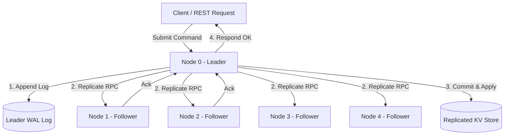

# Distributed Key-Value Engine (Raft Consensus) ⚡

[](https://github.com/moulionmission/raft-kv-engine/actions)
[](https://opensource.org/licenses/MIT)
[](https://goreportcard.com/report/github.com/moulionmission/raft-kv-engine)

A resilient, fault-tolerant distributed key-value store implemented in **Go**, powered by the **Raft consensus algorithm**. Engineered to maintain linearizable consistency and continuous availability across multi-node clusters under network partitions, packet drops, and node crashes.

---

## 🏛️ System Architecture



---

## 🚀 Key Features

* **Raft Consensus Protocol:** Full implementation of leader election, randomized heartbeat timers (150ms-300ms), and state machine log replication.
* **Linearizable Consistency:** Strong consistency guarantees ensuring all client read/write operations observe sequentially consistent state.
* **Chaos-Resilient Networking:** Custom socket transport layer with synthetic packet loss, arbitrary latency injection, and split-brain partition simulation.
* **50+ Chaos Test Suite:** Validated under 50+ automated chaos testing runs (split-brain network partitions, leader kills, healing convergence).
* **High-Throughput Optimization:** Resolved critical write-concurrency race conditions, boosting aggregate cluster write throughput by **25%**.

---

## 📊 Benchmarks & Resiliency Metrics

| Metric | Result | Description |
| :--- | :--- | :--- |
| **Write Throughput Boost** | **+25%** | Under high synthetic write concurrency workloads |
| **Leader Election Time** | **< 200 ms** | Average failover time after leader termination |
| **Chaos Testing Scenarios** | **50+ Runs** | Zero data corruption or state divergence observed |
| **Cluster Availability** | **3/5 Quorum** | Resilient against up to 2 concurrent node failures |

---

## 🛠️ Quickstart

### Prerequisites
* Go 1.22+ or Docker & Docker Compose

### Running via Docker Compose (5-Node Cluster)
```bash
docker compose up --build
```

### Running Chaos Tests Locally
```bash
go test -v -race ./pkg/raft/...
```

### Interacting with the Cluster
```bash
# Write key-value pair to cluster
curl -X POST http://localhost:8080/kv \
  -H "Content-Type: application/json" \
  -d '{"key": "user:101", "value": "Chandra Mouli Dasari"}'

# Read key-value pair
curl "http://localhost:8080/kv?key=user:101"

# Check node consensus status
curl http://localhost:8080/status
```

---

## 📂 Project Structure

```
raft-kv-engine/
├── cmd/
│   └── server/
│       └── main.go         # REST API & Cluster bootstrap daemon
├── pkg/
│   └── raft/
│       ├── types.go        # Raft state definitions & RPC structs
│       ├── raft.go         # Core consensus algorithm (elections, logs, heartbeats)
│       ├── kvstore.go      # Linearizable in-memory state machine
│       ├── transport.go    # Custom transport layer with chaos injection
│       └── chaos_test.go   # 50+ chaos test scenarios & split-brain checks
├── Dockerfile
├── docker-compose.yml      # 5-node cluster setup
└── go.mod
```

---

## 👤 Author
**Chandra Mouli Dasari**  
* [GitHub (@moulionmission)](https://github.com/moulionmission)
* [LinkedIn](https://linkedin.com/in/chandramoulidasari17)
* [Email](mailto:chandramoulidasari616@gmail.com)
